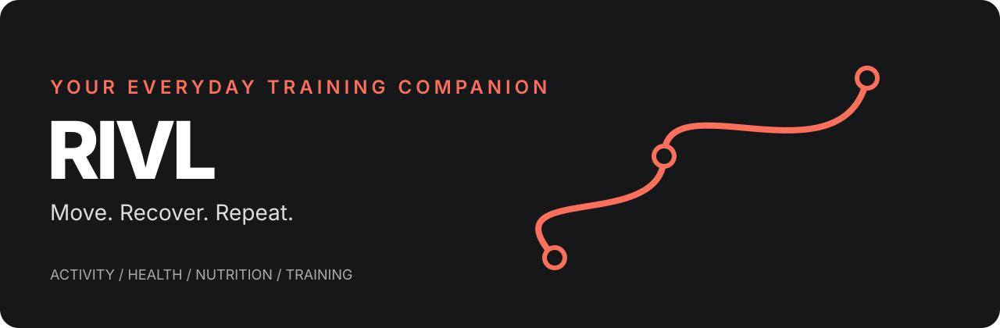

# Install RIVL

RIVL is a native app under development. **For the ready-built iPhone preview, start with the [download and installation guide](SIDELOADING.md) or [video](https://github.com/OjayitTanwar/rivl/releases/download/v1.0.0-sideload.20261017/RIVL-installation.mp4).** Each recipient signs the IPA using their own Apple account. The build-from-source instructions below are for developers.

## iPhone: standalone installation

1. Use a Mac. Install full Xcode, open it once and accept its setup. Select Xcode in Settings → Locations → Command Line Tools. Install Node.js 22 LTS and CocoaPods (`pod` must be available).
2. Download the source ZIP from this repository's Releases, extract it, and open Terminal in that folder.
3. Copy `.env.example` to `.env`. Enter your hosted Supabase URL and **public** anon/publishable key. Never enter an admin/service-role key. Your phone uses the hosted backend; the Mac is needed only to build/install.
4. Connect and unlock your iPhone, trust the Mac, and enable Developer Mode when iOS requests it. Sign in to your own Apple account in Xcode → Settings → Accounts.
5. Run:

```sh
bash scripts/install-iphone.sh
```

Choose your connected phone and signing team when prompted. This builds a Release with bundled JavaScript, so the installed app runs without Metro or your Mac. If provisioning fails, open the generated `ios/RIVL.xcworkspace`, select your team under Signing & Capabilities and use a bundle identifier available to your team. Some capabilities may require an enrolled developer account; do not assume every Health/Watch feature is supported by free signing.



Free Apple provisioning expires; reinstalling refreshes the profile. An IPA signed for another person's phone cannot be installed universally. TestFlight distribution requires Apple's developer/distribution setup and is not included here.

## Free installation without the App Store

[SideStore setup and download](SIDELOADING.md) includes the native IPA, video and renewal instructions. SideStore installation, native entitlements and encrypted data transfer still need validation before replacing a working installation.

## Simulator

```sh
npm ci
npm run ios:simulator
```

## Android developers

Install Android Studio, its SDK and a compatible Java runtime, connect a device or start an emulator, then run:

```sh
npm ci
npx expo run:android --variant release
```

Android release/device behavior is unverified in this release. No verified APK is included. Expo Go cannot provide this app's native Health, SQLite encryption and background recording modules.

## Connect a hosted backend

See [hosted backend setup](HOSTED-BACKEND.md). Without a configured, migrated backend, login/community will not work. Changing public build configuration requires rebuilding the native release. Do not publish your environment files, signing keys or private activity data.
